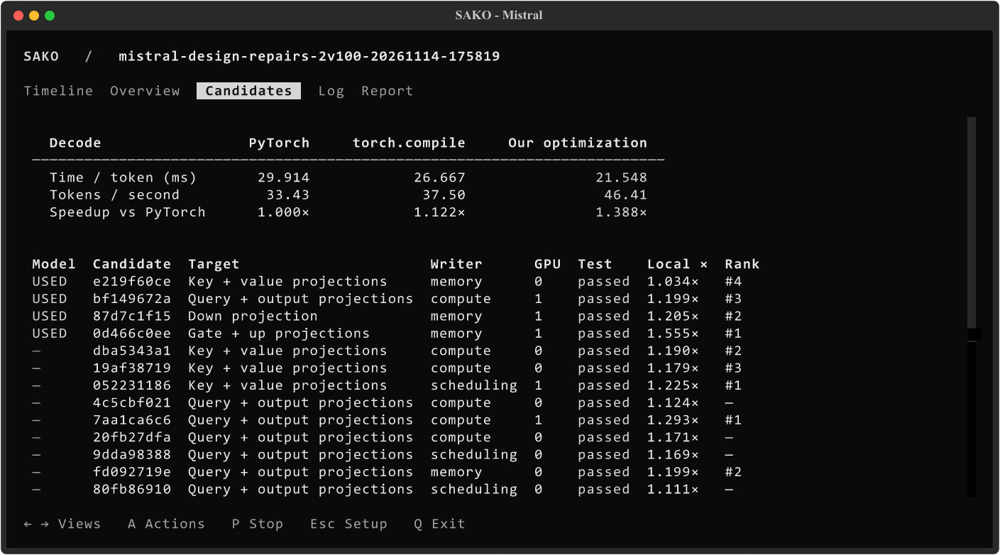
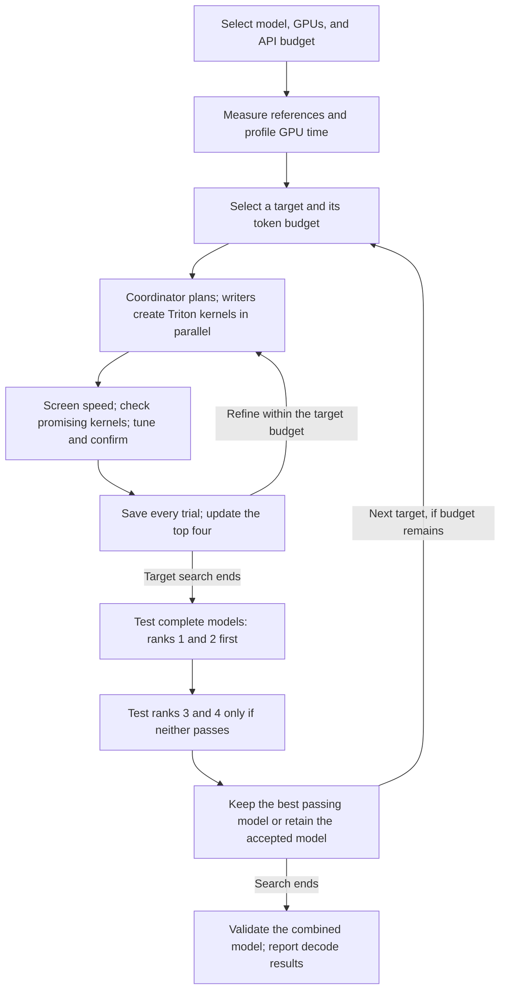

# SAKO — Swarm Agent Kernel Optimization

SAKO uses AI agents to write faster **Triton GPU kernels** for language models.
A kernel is a small program that runs one operation on the GPU.
SAKO improves execution code. It keeps the model weights and precision unchanged.

It supports compatible Hugging Face models, including Qwen, Mistral, and Llama.
The agents can use **Vertex AI or DeepSeek**.



*Current terminal view of the saved Mistral results. The table compares normal
PyTorch, `torch.compile`, and our optimization. `USED` marks the selected kernels.*

## How it works

1. Measure the model with normal PyTorch and `torch.compile`.
2. Profile GPU time and select slow operations.
3. Ask a coordinator and up to five writers to create different Triton designs.
4. Test kernel speed, check promising results, and refine the designs.
5. Test the best candidates in the complete model. Keep a change only when it
   passes correctness checks and improves decode speed.

SAKO saves all candidates, failures, and raw timings. Two GPUs can test separate
candidates in parallel. Each model must fit on one GPU.



Each model test must pass correctness and show a stable decode gain over the
accepted model and the compiled reference. Two GPUs can test each pair in parallel.
If all finalists fail, eligible model failures can use reserved tokens for repairs
and new tests. Skipped candidates remain saved.

## Setup

You need Python 3.10+, an NVIDIA GPU server running Linux, and SSH access.
The server needs compatible CUDA, PyTorch, and Triton versions.

Clone the project on the controller and the GPU server:

```bash
git clone https://github.com/hdnguyen1802/swarm-agent-kernel-optimization.git
cd swarm-agent-kernel-optimization
```

On the Windows controller:

```powershell
python -m venv .venv
.venv\Scripts\python -m pip install -e ".[ui,agent]"
```

On the GPU server, from the project folder:

```bash
bash scripts/setup_gpu.sh
```

The setup script uses the tested V100 software versions. Other GPUs can need
other versions. For Colab, see [Colab setup](docs/colab.md).

## Configure

Create a private config on the controller:

```powershell
New-Item -ItemType Directory -Force .local | Out-Null
Copy-Item configs/generation.json .local/my-config.json
```

For DeepSeek, copy `configs/generation-deepseek.json` instead.
Edit the private copy:

- `model_id` and `revision`: the Hugging Face checkpoint to optimize.
- `worker`: SSH host, key path, server folder, Python path, CUDA path, and GPU.
- `agent`: API provider, agent model, and API settings.
- `agent.max_total_tokens`: search budget. The templates use **1,000,000 tokens**.

For two matching GPUs, set `worker.gpu` to `0` and set `worker.archive_gpu` to `1`.
The agent model writes code. It is separate from the checkpoint under `model_id`.
Restricted checkpoints need Hugging Face access on the GPU server.
Keep credentials, weights, and private configs outside Git.

Set credentials on the controller before starting a run.
For Vertex, set `agent.project` and `agent.location`, then use Google credentials:

```powershell
$env:GOOGLE_APPLICATION_CREDENTIALS = "C:\path\to\credentials.json"
```

For DeepSeek, enter the key without saving it in command history:

```powershell
$key = Read-Host "DeepSeek API key" -AsSecureString
$env:DEEPSEEK_API_KEY = [System.Net.NetworkCredential]::new("", $key).Password
```

## Run

From the project folder on the controller:

```powershell
.venv\Scripts\python -m sako ui --config .local/my-config.json
```

Select **Optimize a model → Configured worker → Search and test the model**.
Choose a new run folder, review the settings, and start.
The interface handles source transfer, profiling, search, and final tests.
Use a new run after changes to the source, model, GPU, or test settings.

To test API access first, run this command. It uses a small API request:

```powershell
.venv\Scripts\python -m sako api-check --config .local/my-config.json --run runs/api-check
```

## Read results

The terminal compares **PyTorch → torch.compile → our optimization**.
It shows **ms/token**, **tokens/second**, and **speedup versus normal PyTorch**.
Decode timing excludes prompt processing. `USED` marks kernels in the final model.
A local kernel gain alone does not prove a complete-model gain.

Results stay under `runs/<name>/`, including `report.md` and `report.json`.
Open a saved run with:

```powershell
.venv\Scripts\python -m sako ui --run runs/<name>
```

## Tests and details

```powershell
.venv\Scripts\python -m unittest discover -s tests -v
```

See [measured results and checks](docs/validation.md) or the
[harness design](docs/architecture.md).
