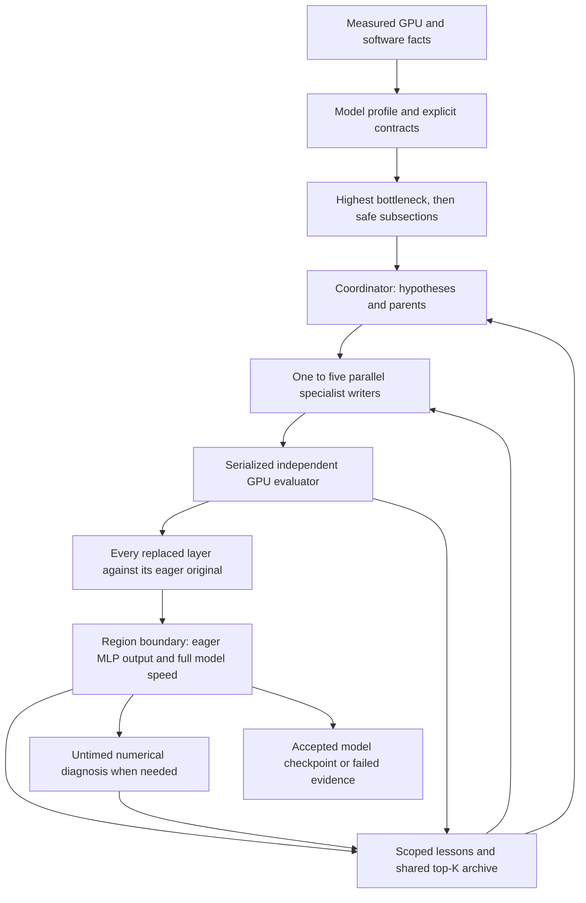

# Swarm architecture

The candidate language is Triton Python. The controller supplies measured tasks
and a Triton writer prompt. Each candidate declares its backend. The
worker checks that declaration against the run config before loading any code.
The same custom operation interface exposes shape metadata to torch.compile.
The evaluator loads Python source from its saved build directory. Triton compiles
specializations on first use, before benchmark timing. Full model integration uses
the validated Triton wrapper and the declared numerical gates.
Source checks restrict imports, host computation, precision changes, mutable
state, and suppressed errors. These checks are not a security sandbox.

The default configuration uses `search_mode="swarm"`. One coordinator assigns
distinct hypotheses to up to five specialist writers. Ordinary code owns the budget,
state, evaluator, profiler, and acceptance rules. Agents cannot supply a measured
result or change the numerical test contract.

## Roles and concurrent work

The API boundary uses one factory for `agent.provider="vertex"` or `"deepseek"`.
The shared agent code owns the budget ledger, concurrent call gate, response
cache, cooldown, and retry limits. The Vertex adapter uses Google credentials.
The DeepSeek adapter reads a key from an environment variable and uses HTTPS
Chat Completions. The selected provider and model are visible in the terminal.
Neither API can set GPU test results or bypass acceptance.

DeepSeek uses JSON mode. Its system message contains the coordinator response
structure, and the controller validates the result. Input reservations use a
local UTF-8 byte bound, including the extra instructions and framing headroom.
The call log marks this bound as local, rather than a remote token count.
Reported total usage replaces the reservation. Reasoning tokens remain part of
that total. Unknown outcomes keep their reservation. Provider identity, model,
request settings, and schema separate cached responses. A provider change needs
a new run and does not select a different model for GPU evaluation.

The default search keeps kernels before full model integration. Each valid candidate
races the current kept kernel for its operation. The first race uses the compiled
reference. Every required case must pass the accuracy, input, trial, p95, and 1.01
throughput ratio gates. The evaluator returns the baseline ID and raw paired samples.
The controller checks that the measured baseline is still current before promotion.
An old result cannot replace a newer kept kernel during resume.

The default archive score uses fresh paired timings against `torch.compile`.
For cached generation, archive order uses estimated saved GPU time from the
measured phase costs and paired ratios. Each phase counts once. Repeated seeds
and cache lengths do not multiply that cost. Other workloads use the geometric
mean of the per-case ratios. The initial acceptance pair is reused while the
reference is `torch.compile`. After a keep, a separate
pair measures the original compiled reference and the candidate for ranking.
Missing ranking samples give no score. Each keep uses its fresh pair against the
current baseline. Configs that select `fixed_anchor` use saved reference times.
A single GPU queue finishes
each review before it selects the baseline for the next candidate. Writers can
start queued ideas during GPU evaluation.

In accepted-model mode, the search tests each promoted kernel with the accepted
model while correction attempts remain. It also combines kept subsections when
a region finishes. Each accepted addition must improve the current model. The
combination must pass the configured compiled-model gate. Adaptive sampling
compares its gain with the saved accepted gain against the same original model.
The error range must show an improvement. This check adds no timed runs. Fixed
sampling uses a second paired test against the accepted model. It requires no
median or p95 regression and an improvement on at least one workload. It requires
each replaced layer to pass against eager outputs. Containing-MLP differences are
diagnostic for child replacements. A whole-MLP replacement still needs to pass at
its own output. The separate `integrate` command also tests kept kernels after search.
The manifest declares target workloads before timing. Targets need a complete model
gain under the configured speed gate. Current defaults require a positive gain;
older saved configs retain their limits. Other workloads need at least 1.0. All retain the p95
gate. A numerical failure can restrict a candidate to verified paths. The smaller
manifest must pass a fresh model test. Export requires a passing model measurement.

The coordinator reads hardware facts, contracts, saved results, model rankings,
lessons, and budget. It returns `continue` or `move_on`, a reason, evidence IDs, and
hypotheses. Each hypothesis declares its specialty, parent, objective or claim,
expected metric, and evidence. Algorithm and setting suggestions are advisory.
The writer selects its method, settings and observable checks. It returns its
design and source in one response. Evidence records the requested goal and the
actual design separately. The evaluator applies the same operation, precision,
input and accuracy rules. The controller checks the plan before paid writer calls.

The five specialties are memory, compute, scheduling, fusion, and register use.
These are search directions. They do not own private candidate archives. There is
no separate hardware, performance-analysis, or integration LLM call in swarm mode.
The coordinator performs the needed interpretation in one role.

The active writer count depends on distinct hypotheses, free slots, estimated
budget, and the maximum of five. A plan can queue further hypotheses. Duplicate
transformations from the same parent are rejected. Legacy algorithm proposals
keep the same identity rules. Objective-based assignments can give the same goal
to different specialties so each writer can select its own method.

The controller handles a completed writer without a full-round barrier. It tests
the result and refills free slots when useful work fits. Each new writer reads
completed lessons. Work in progress keeps its original prompt. The selected parent
source is fixed for the assignment. A new archive ranking cannot replace that source.

One GPU lock covers evaluation, profiling, model checks, and diagnosis. Several
LLM writers can run while the GPU tests one candidate. The lock only coordinates
this project's jobs under its worker account. It cannot exclude another user's job.

## Device facts and profile scope

The worker reads device identity, compute capability, memory, thread limits, and
software versions. The compiler target comes from those facts. Unsupported targets
stop preparation. Build identities include a hardware and software fingerprint.
Changing the device, software, workload, or evaluator requires a new prepared run.

Fixture capture and functional verification finish before timed model profiling.
The default priority queue uses a compiled profile. Compilation and warm-up finish
before timing. The compile mode matches the full model reference. Diagnostic
options save source maps and unique kernel names without extra tuning.
The adapter links measured CPU self GPU events to generated launch order and
Dynamo source nodes. Names and counts must match. Device events are not added again.
User Triton calls can lack source comments. In that case, the adapter matches the
actual kernel name and exact graph-input positions. Ambiguous owners remain
unmapped. Each workload has equal weight after its median. Missing coverage
prevents selection.

A contract must contain the complete fusion groups that touch it. An MLP contract
can contain fusion across child operations. Cross-boundary and unmapped work stays
in the report. It does not authorize partial replacements or guessed layer times.
The adapter preserves generated code, source maps, traces, and raw samples. Agents
receive compact evidence and kernel examples. Eager capture still supplies accuracy
outputs. Contracts still determine executable targets. Selected paths cannot overlap.
The selector has no fixed top-four limit. It searches one region and its supported
subsections before moving to another region. It does not fill slots with guesses.

The old eager modes remain available. Preparation binds the chosen mode to the
saved catalog. A change needs a new profile and run. Compiled ranking reuses its
baseline timing report instead of repeating the earlier compiled diagnostic pass.

When a hypothesis requests launch details, the evaluator records them outside timed trials. For CUDA graphs it uses host correlation IDs to identify the graph nodes in a replay.

## Candidate validation and model acceptance

The fixed Triton entry point accepts tensor inputs and scalar values and returns one
new tensor. The trusted worker supplies inputs and compiles source. Candidates must
preserve weights, inputs, precision, supported shapes, and operation rules. Static source checks are not a security sandbox.

In the default mode, fixture capture saves the actual original eager module output.
Its path, workload, seed, and case index bind it to the captured inputs. Attention
outputs use the candidate API layout. Operation tests require this saved output and
check three candidate calls against it. Compiled-baseline differences remain diagnostic.
The evaluator checks output correctness and unchanged inputs before timing. Paired
samples compare the candidate with the compiled operation baseline. Every case must
pass the declared correctness, minimum gain, and p95 gates. Compiler resource reports
and complete timing arrays remain in evidence files.

Kernel-first search with a kept-only trial base defers model checks until
integration or a numerical repair. Accepted-model mode checks promotions early. The
manifest contains that exact candidate, not a faster older sibling. Previous accepted
replacements may remain in the combination. Ordinary code checks replacement overlap.
The default accuracy policy is `correctness_scope="replaced_layers"` with
`correctness_reference="eager"`. Every configured workload and seed visits every
replacement path. The checker uses that exact eager module's input and real weights.
Candidate outputs do not feed later reference layers. The original eager trajectory
therefore supplies each local comparison. The check covers linear, embedding, RMSNorm,
MLP, and attention core replacements. Missing paths cannot pass.

The checker validates output metadata, finite values, numerical limits, and unchanged
inputs. It restores rejected value mutations before reference execution continues.
If restoration fails, it aborts later reference checks and all timing on that model.
Later cases remain explicit as not measured. No path limit reduces this coverage.

The complete speed reference is the original model under `torch.compile` with
`fullgraph=True`. After layer checks finish, hooks are absent while both complete
compiled models run through the paired timing test. Only these complete timings can
establish a model speed gain. The default policy has no final-logit numerical gate.
Acceptance means local eager layer accuracy plus complete model speed. It does not
establish final-output numerical equivalence. Older configs without the policy keys
retain the original final-output gate.

The best accepted model checkpoint remains separate from the search archive. A later
failure cannot remove it. A failed combination does not prove that every member caused
the failure. The active replacement can receive a separate model check for diagnosis.

## Adaptive model measurements

The adaptive policy measures the original model five times through the normal
compiler path. It saves all samples and the exact input, model revision, GPU,
cache, math and compiler settings. JSON metadata uses one canonical form.
The cache rejects different settings, software, source, tokens or GPU identity.

Warmup has separate records. The first stable window of three runs sets the
saved count. The maximum is twelve. A later test uses that count and extends
warmup if needed. Compilation and warmup do not enter acceptance samples.

The profiler starts with five traces. It compares the first two and last three
trials. The top target order must match. Target cost ranges must stay within 10%
of their medians. An unstable rank gets batches of five, up to fifteen traces.
The resulting profile records stable or uncertain rank evidence. Each workload
keeps its actual trace count. Missing trials do not become zero-valued samples.

The profiler checks scores, tokens and the complete KV cache against the normal
compiler path. It loads the saved starting times. The baseline worker action
also loads these times. It does not load weights, scan parameters or execute a
model. Preparation binds the catalog to the source, hardware and test settings.

Final model tests run accuracy checks first. They then collect five alternating
pairs against the original model. Another five pairs run if the timing range
exceeds 2%, the median gain is within 0.5% of the required ratio, or the interval
crosses that ratio. The interval uses log ratios and a conservative 99%
Student-t estimate at each of two declared looks. The model assumes suitable
paired timing errors; the interval does not prove independence.

Every collected sample remains in the decision. Ten unclear pairs produce an
uncertain result. That result cannot replace the accepted model. A comparison
with an accepted model uses its saved gain against the same original model.
It adds no timed runs. A config without adaptive sampling retains fixed trials.
Operation tests retain their separate trial count.

## Numerical diagnosis and repairs

A repair retains failed source, operation, workload, seed, error limits, and evidence.
A free specialist can take it. Each logical hypothesis has one initial attempt and
two corrections. Reassignment and resume keep that hypothesis ID and attempt budget.
Exhaustion closes the hypothesis, not the operation. The coordinator can request a
different experiment. No failure becomes acceptance, and raw evidence remains available.

The `diagnose_model` worker action is untimed. It selects an existing workload and
seed. It compares selected replacement boundaries under eager execution. It reports
the first exact difference, first tolerance failure, and first local failure when the
original module receives the same candidate-trajectory input. Skipped or unmatched
paths remain explicit.

This is an eager boundary trace. It does not reveal the first internal divergence in
the compiled graph. This bounded diagnostic can guide a repair, but it cannot replace
the acceptance check across all paths, workloads, and seeds. Its result always records
`acceptance_evidence=false` and remains separate from acceptance timing samples.

## Shared lessons

Each lesson contains operation context, hardware fingerprint, candidate and parent
IDs, scope, status, observations, hypothesis, and evidence links. Scope includes
shapes, dtypes, strides, scalars, operation semantics, and numerical limits.

The statuses are `supported`, `failed`, and `untested`. They describe the measured
candidate outcome. They do not prove an agent's causal explanation. The explanation
remains labeled `agent_hypothesis`. Operation and model records have separate scopes.
Combination failures retain combination-only attribution.

Infrastructure failures are untested CUDA hypotheses. A correct but slow candidate
has a measured performance failure, with correctness reported separately. Supplied results must match saved
trusted evidence. Agents cannot replace measurements with their own claims.

Lessons have stable content IDs. SQLite serializes writes and retains immutable
full evidence. Correction links point to newer evidence in the same scope. Old
records remain available. File copies use separate temporary names for concurrent
writers.

Default recall permits eight relevant lessons within 12,000 characters. It includes
failures and supported results where space permits. It requires matching hardware
and operation context. Full conversations and raw timing arrays stay outside the
normal lesson prompt.

## Shared parent archive

The active archive has four entries per operation by default. It keeps the fastest
correct design, then favors different hypotheses and measured resource patterns.
A slower correct alternative can remain. All original candidates and failed trials
remain in the full store after they leave the active archive.

Every specialist can select from this archive. Assignments record the parent and
reason. Candidates without finite timings cannot enter it. Candidates with model
correctness failures require explicit repair. Untested model candidates remain
labeled untested. The accepted model checkpoint is separate.

The coordinator sees each parent's operation measurements, model result, and use
counts. It should compare promising parents that have not yet been refined.
When ordinary parents exist and no ordinary refinement is active, a continue plan
must include one. A repair does not count as an ordinary refinement. Validation
places repairs first, then archive refinements, then fresh designs. This prevents
a limited dispatch from selecting only fresh designs.

Each fresh hypothesis must explain `fresh_start_reason` and cite a parent it
considered. To omit all ordinary refinements or move on, the coordinator must give
`archive_skip` with a reason and evidence from an eligible parent. This permits a
different design when measurements show low value in further parent work. The
controller records this choice. Reports distinguish source choices for started
writers from choices that remain planned. They count repair work separately.

The default swarm has no scheduled migration. Shared parent selection supplies
ideas across specialties directly. Archive size and writer count are experiment
settings, not evidence that those values are optimal.

## Budget and stopping

Before model timing, every required local layer check must pass. A failed check
prevents compilation and timing for all workloads. The worker retains each check
and a timing skip reason. It does not create timing samples for skipped work.

A rejected combination that passed accuracy does not need an automatic isolated
model test. The controller retains the combination result and records this skip
in the repair evidence. A combination accuracy failure still triggers isolation
of the new entry. A failed speed gate does not block a candidate as incorrect.

A numerical failure at integration creates a durable repair ticket. The ticket
preserves the failed path, workload, seed, exact numerical examples, tested manifest,
and retired keep. The original hypothesis uses its remaining correction attempts.
The operation result remains immutable. A live region check reopens the affected
task before the controller completes the region. A deferred `integrate` call can
set `integration_repair_pending`; a later `search` call resumes that repair on the
same source and evaluation contract. A corrected keep must revisit integration.
No failed model result can establish a model speed gain.

Coordinator prompts use summaries of parents, trials, and hypothesis states.
The controller saves each full request and rejected reply before compaction.
Both initial requests and retries must fit the existing character limit. Writers
keep the full selected source and bounded numerical repair evidence.

The default GPU worker stays resident on one checked SSH stream. It bundles the
small files needed for each job, then returns the result on that stream. The worker
reuses one pinned reference model and one compiled baseline. Each candidate still
gets fresh layer checks and paired timing samples against that baseline.

The worker holds the GPU lock for its connection. Exact CPU parameter copies let
it reject native writes to the resident reference. A worker with resident weights
runs fixture trials in a separate process. That process loads saved fixtures and
reuses its compiler across trials. Fixture capture still uses and checks the
original model. The worker retires after unsafe state, after 64 jobs, after 600
idle seconds, or when the run closes the connection. The
process boundary does not isolate native candidate code as a security sandbox.
Diagnostics that load another model first release the cached model to limit GPU
memory use. Each process keeps only one reference contract active.

The controller saves the complete request before sending it. The worker claims its
job ID in SQLite before execution and saves the result before replying. Reconnects
read that result. Repeated requests with the same ID cannot run twice. Different
inputs cannot reuse an existing ID. Older configs retain the one-shot path.

Stage records separate model resources, native builds, layer checks, first warmup
calls, paired timing, exact state checks, GPU lock wait, and transport wall time.
The worker does not reduce test coverage to improve harness throughput.

The default hard cap is 1,500,000 tokens. SQLite reserves tokens before each request.
Known usage replaces the reservation. Unknown outcomes retain it. Input, output,
and reported reasoning use count toward the same cap. Metadata and generation
requests have separate ledger counts. This is not a currency limit.

Cost estimates use the latest 12 successful writer or coordinator calls, their
median, and a 15 percent margin. Bootstrap estimates use twice the output limit.
Admission funds the next writer experiment plus a coordinator reserve. It can admit
one to five writers. It does not require three migration rounds before starting.

At task start, the controller divides remaining tokens among remaining priorities
to set the task allowance. This protects later operations. Actual requests can
differ from estimates, and the hard cap takes priority. Reports show unvisited
priorities and the remaining balance.

The coordinator can request `move_on` with a measured candidate from the current
operation. It must explain why another experiment has low expected value. This rule
applies to every operation type. API, source, compile, execution, and transfer errors
do not establish a performance plateau. Measured numerical or timing outcomes can
update progress, but the plateau counter alone does not close an operation.

The controller also enforces budget availability, STOP, and optional
`max_task_experiments`. This guard is `null` by default. A failed hypothesis uses its
bounded corrections; it does not impose an operation-wide failure limit. Infrastructure
and request failures remain distinct. Legacy migration settings do not impose swarm rounds.

Every task and final stop records the decision source, reason, evidence, and tokens.
A correct candidate can fail speed gates, enter the archive, and provide useful
evidence. Only complete model acceptance permits export.

## Persistence, transport, and reports

SQLite keeps assignments, queued hypotheses, lineage, lesson use, costs, results,
and events. Resume reuses saved successful responses and measurements. Uncertain
API outcomes retain reservations. Resume never resets spent tokens or test limits.

SSH uploads and downloads have bounded retries and deadlines. Temporary files and
hashes protect publication. Proven pre-dispatch failures can retry. An uncertain
disconnect permits recovery of the original result, not a second job. Authentication,
host-key, and permission failures stop immediately.

The paced resume driver bounds connection starts and recovery attempts. Pacing is
outside GPU timing. Full transfer diagnostics and job identities remain available.
A process boundary is not a security sandbox.

`report.md` and `report.json` separate operation decisions from model decisions. They
show per-case correctness and speed reasons, parents, hypotheses, repair outcomes,
lessons, observed writer overlap, budgets, and stopping reasons.
Numerical diagnostics state their actual scope. The full model test determines the measured gain.

## Run compatibility

The Triton swarm is the only search controller. The old island loop, advisory
hardware call, and local reference index are removed. The validation config
also uses the swarm.

Old run folders keep their config and evidence. Saved report files remain available.
New source requires a fresh run and profile. The controller audit checks stopped
swarm runs and preserves their token ledger. It cannot convert an island run.

## Validation limits

- Only complete model measurements can establish model speed gains.
- Eager timing attribution and boundary traces have narrower scopes than the compiled model.
- Fixed shapes and seeds do not prove correctness for all possible inputs.
- Local eager layer accuracy does not prove final-output numerical equivalence.
- Five writer slots and four archive entries need controlled comparisons.
- The API cap may stop work before every operation receives an experiment.
- Failed trials, raw samples, and prior accepted results remain available.

Core changes require `python -m unittest discover -s tests -v`. Live checks use the
unchanged model, inputs, precision, numerical limits, and complete compiled baseline.

## Bottleneck tree

The default bottleneck tree ranks regions by measured GPU time. Inside each
region it queues the smallest verified operations with independent compiled
timings. If none qualify, it queues the region itself. A configuration with
`agent.search_parent_regions=true` also permits a whole-region alternative.
At region completion the harness tests kept replacements in the full model.

The controller completes the active region before it visits another region. It
does not divide the token cap equally among a fixed set of four targets. The
coordinator closes a subsection with measured evidence. At a region boundary,
kept kernels receive required eager checks at each replaced layer. Containing MLP
checks are diagnostic unless the candidate replaces the whole MLP.
Only a model that passes the full speed gates can become the accepted model state.
A change to that state triggers a fresh compiled profile when another region
remains. The controller reorders future regions from that profile. It reuses the profile when the model is unchanged.
Saved decisions and the prepared catalog remain immutable during this process.

The budget stop drains already-generated outputs without more API calls. It does
not start new writers or relax any gate. Reports keep region decisions, profile
changes, the token ledger, and full errors. The earlier flat selection remains
available. Changing selection mode requires a new profile and run.
