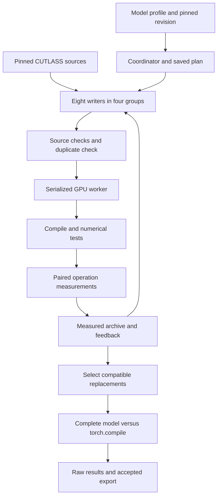

# Harness design

The controller owns the experiment. Agents supply candidate code and advice.
The GPU worker owns the measurements. Agent messages cannot supply a test result.

## State and context

The SQLite database stores candidates, parent IDs, measurements, and API reservations.
The plan uses a separate state entry and JSON file. Every writer receives the plan.
The prompt contains recent feedback and selected source excerpts.
If it exceeds the limit, the controller removes old feedback and then source excerpts.
It keeps the task and the selected parent source. It refuses a request that still exceeds the limit.
Raw observations stay on disk. The current implementation does not use an LLM summary tool.

Each group normally selects its own eligible candidates. An empty group starts fresh.
After each migration interval, the controller creates a saved transfer plan.
Only the second writer of each group can use its planned migrant in the following round.
Repairs take priority. A transfer can change the next task, but the task must match the migrant.
The parent guard checks source membership, task, writer, round, and event before each request.
There is no foreign-parent fallback. Failed source is available through explicit repair assignments.
The archive keeps all attempts, including rejected code. A source hash removes duplicates.
This is an island search with a measured archive. It is not a full MAP-Elites implementation.

The archive stores membership separately from the first source origin. When two writers
independently submit identical code, the evaluator reuses the measured result. The archive
records the duplicate and both island memberships. It does not grant membership merely
because another island has that code. Selection files record every assignment, including
assignments whose API request fails. Emission records describe proposals that actually returned.
Migration files describe planned or skipped transfers. A migration selection record shows actual use.

## Repair loop

The full model test runs inside each generation. A failed test creates a saved repair
assignment for the writer that supplied each selected candidate. The writer receives
the exact source, failed workloads, seeds, numerical limits, and error examples.
It keeps the task until a repair passes or reaches the repair limit.
Raw reports stay on disk. Prompts omit raw timing arrays but keep test summaries.
Several failed tasks can wait for one writer. The queue keeps each task separately.
The controller rechecks repaired code at the operation and model levels.
For each task, it first considers the latest generation. It then compares operation scores.
A failed combination does not prove which member caused the failure. Writers receive
the full combination report. The controller excludes failed selected candidates and
keeps the best measured model result in a separate checkpoint.

## Test boundary

The candidate ABI returns one tensor. It takes a list of input tensors and scalar values.
The trusted worker supplies inputs, compiles the source, and checks the output.
The wrapper registers a PyTorch custom operation so Inductor can retain a complete graph.
The custom operation has an explicit output shape rule and declares no input mutation.

The full model test shares read-only parameter tensors between two module trees.
This avoids a second copy of the model weights. It compiles both trees with the same mode.
Tests use CUDA device 0 in the worker's visible device list.
Two calls on the same worker cannot benchmark at the same time.

The current adapter covers Qwen2 linear, embedding, RMSNorm, MLP, and attention core operations.
It supports FP16, SDPA, no cache, and no sliding attention. Rotary operations and residual
adds stay in the original model graph. The adapter is not a general model compiler.
Add a new adapter and numerical tests before you use another model architecture.

## Why it is a harness

The project defines the agent loop, tools, inputs, observations, state, budgets,
execution rules, and stopping conditions. It supplies the same environment for each trial.
It also owns the independent evaluator. This lets an experiment compare search methods
without changing the workload or the test rules.

## Current limits

- Eleven roles are a design choice. No agent-count study has validated that choice.
- A source filter and a separate process do not provide a security boundary.
- Hook times provide a search order. Nested operation times must not be added together.
- Fixed shape tests do not prove correctness on all shapes or inputs.
- Several candidates can pass operation tests and still fail the model test.
- The search does not automatically remove one candidate at a time after a model failure.
- A faster isolated operation does not prove a faster complete model.
- Current API budgets count calls and tokens. They do not calculate a currency limit.
